# Risk-Aware Emergency Vehicle Path Planning using Large Language Models, RRT*, and Model Predictive Control

The proposed framework integrates **LLM-based collision reasoning**, **Risk-Aware RRT***, **Spline2D trajectory generation**, and **Model Predictive Control (MPC)** into a unified autonomous emergency planning system for **Sudden Unintended Acceleration (SUA)** scenarios.

> Capstone Design 2 · Chung-Ang University · Fall 2024 · team project (4 members)

| LLM-Based Prompt Engineering | Motion Planning & Trajectory Tracking | End-to-End Emergency Planning |
|:----------------------------:|:------------------------------------:|:-----------------------------:|
|  |  |  |

## Project Focus

<p align="center">
  
  
  
  
  
</p>

## Table of Contents

- [Project Overview](#project-overview)
- [My Contributions](#my-contributions)
- [Motivation](#motivation)
- [System Architecture](#system-architecture)
- [Methodology](#methodology)
  - [LLM-Based Collision Reasoning](#llm-based-collision-reasoning)
  - [Motion Planning](#motion-planning)
  - [Trajectory Generation](#trajectory-generation)
  - [Model Predictive Control](#model-predictive-control)
- [Simulation Environment](#simulation-environment)
- [Experimental Results](#experimental-results)
- [Software Stack](#software-stack)
- [Repository Structure](#repository-structure)
- [Future Work](#future-work)
- [References](#references)

---

## Project Overview

<p align="center">
  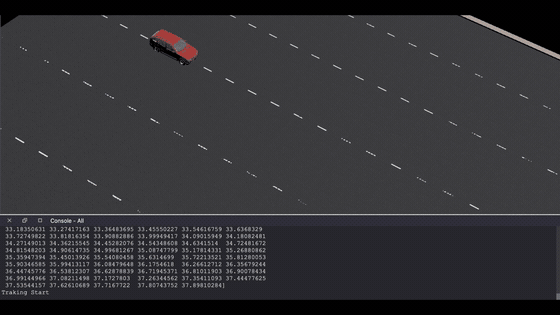
</p>

This project presents an AI-assisted emergency planning framework for unavoidable traffic collision scenarios.

Instead of focusing solely on obstacle avoidance, the proposed framework investigates how an autonomous system can minimize overall human casualties when a collision becomes unavoidable.

The system combines semantic reasoning from a Large Language Model, risk-aware motion planning, trajectory smoothing, and optimal vehicle control.

```text
Environment Representation
        ↓
LLM-Based Collision Reasoning
        ↓
Risk-Aware RRT*
        ↓
Spline2D Trajectory Generation
        ↓
Model Predictive Control
        ↓
Webots Simulation
```

---

## My Contributions

| Area | Contribution |
|------|--------------|
| System Integration | Designed and integrated the complete **LLM → Planner → MPC → Webots** pipeline. |
| LLM-Based Decision Making | Designed prompt engineering strategies, implemented environment parsing, and connected semantic reasoning to the planning pipeline. |
| Planning & Control Interface | Designed the Spline2D trajectory generation module and built the interface between motion planning outputs and MPC trajectory tracking. |
| Software Engineering | Designed modular class structures and reusable interfaces to improve readability, maintainability, and scalability. |
| Simulation & Validation | Integrated the complete framework into Webots, executed experiments, debugged the system, and recorded demonstration videos. |

---

## Motivation

<p align="center">
  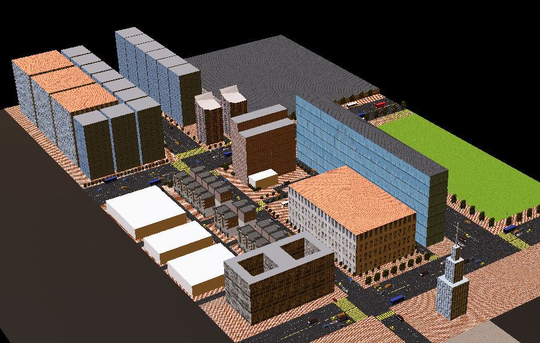
</p>

The simulation map recreates the area around Seoul City Hall Station, where a sudden-acceleration crash in July 2024 killed 9 people and injured 7.

Autonomous vehicles may encounter emergency situations where collisions cannot be completely avoided.

Conventional autonomous driving systems primarily focus on collision avoidance. However, once a collision becomes unavoidable, the remaining challenge is no longer whether to collide, but how to minimize overall human casualties while maintaining dynamically feasible vehicle behavior.

This project investigates whether Large Language Models can support emergency decision-making by selecting safer collision targets, followed by motion planning and optimal control.

---

## System Architecture

The proposed framework integrates semantic reasoning, motion planning, trajectory generation, and vehicle control into a unified emergency planning pipeline.

The LLM determines the collision-minimizing target, while the planning and control modules convert that decision into a dynamically feasible vehicle trajectory.

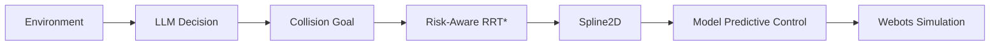

<p align="center">
  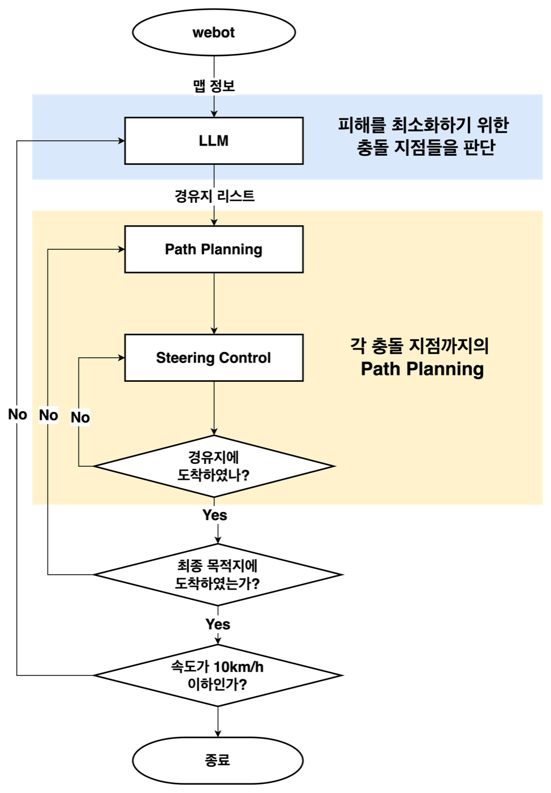
</p>

---

## Methodology

The proposed framework consists of four sequential modules:

1. LLM-Based Collision Reasoning  
2. Motion Planning  
3. Trajectory Generation  
4. Model Predictive Control  

Each module transforms high-level emergency reasoning into executable vehicle behavior.

---

### LLM-Based Collision Reasoning

The LLM performs high-level semantic reasoning to determine collision strategies that minimize overall casualties.

Rather than directly producing control commands, the LLM selects a collision goal based on structured environment information.

```text
Environment Data
        ↓
Prompt Construction
        ↓
LLM Reasoning
        ↓
Collision Goal
```

#### Environment Representation

The Webots simulation environment is converted into structured data that can be interpreted by the LLM.

The parser extracts semantic objects such as vehicles, pedestrians, roads, sidewalks, buildings, and obstacles.

<p align="center">
  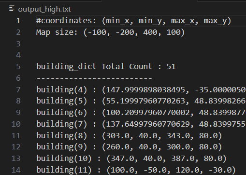
</p>

#### Prompt Engineering

The prompt is designed to separate the driving scenario, environmental constraints, vehicle state, and expected output format.

This structure improves reasoning consistency and reduces ambiguity.

- Prompts are written in English, with the scenario, constraints, and initial conditions clearly separated.
- Priming examples guide the model to propose a concrete deceleration strategy at each waypoint.
- Few-shot examples are used to keep the output format consistent.

#### Prompt Verification

Before collision reasoning, the generated environment description is verified to reduce parsing errors and hallucinations.

<p align="center">
  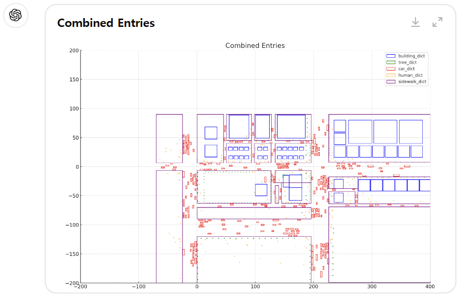
</p>

#### Collision Goal Generation

The LLM generates a collision-minimizing target, which is passed to the motion planning module.

<p align="center">
  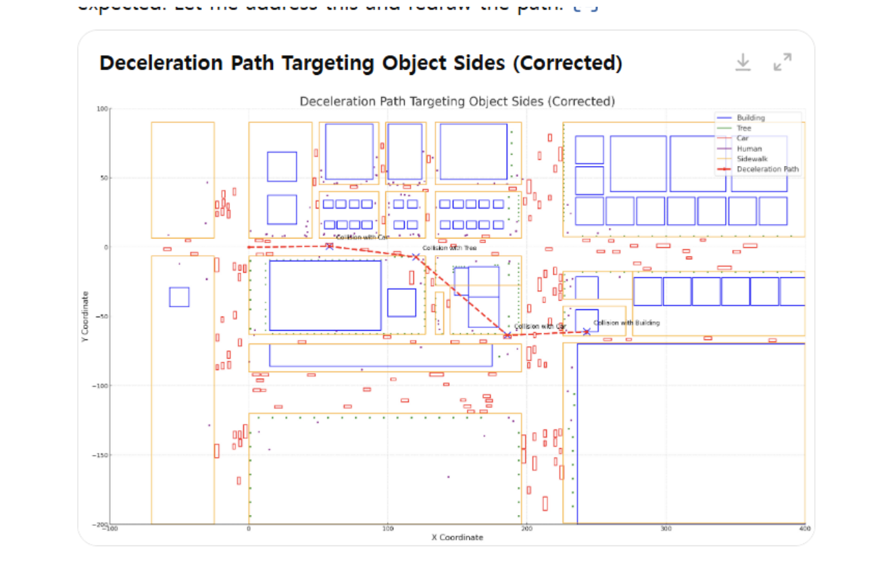
</p>

<p align="center">
  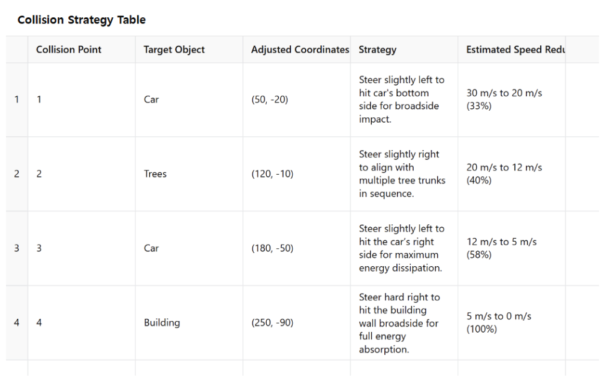
</p>

---

### Motion Planning

After the LLM selects a collision goal, the planner generates a feasible trajectory from the current vehicle state to the target.

```text
Collision Goal
        ↓
Occupancy Grid
        ↓
Risk-Aware RRT*
        ↓
Waypoints
```

#### Occupancy Grid

The environment is converted into an occupancy grid for collision checking and path planning.

<p align="center">
  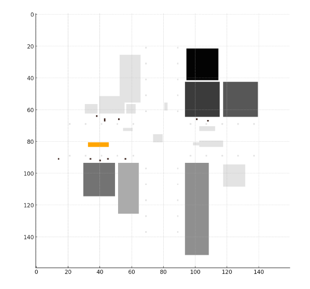
</p>

#### Risk-Aware RRT*

A risk-aware RRT* planner generates a collision-aware path while considering obstacles and pedestrian locations.

<p align="center">
  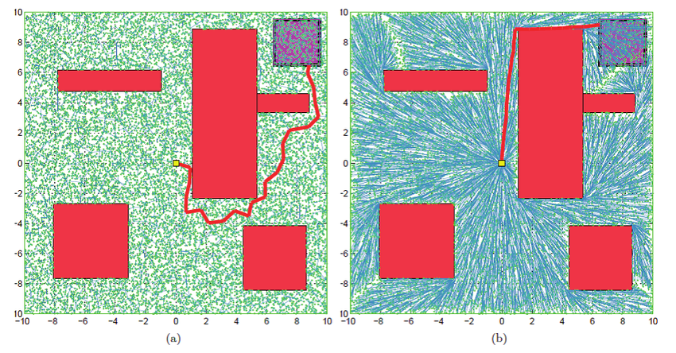
</p>

#### Pedestrian-Aware Gaussian Bias Sampling

The planner applies Gaussian bias sampling to reduce path generation near pedestrians.

This encourages safer trajectories while preserving planning efficiency.

<p align="center">
  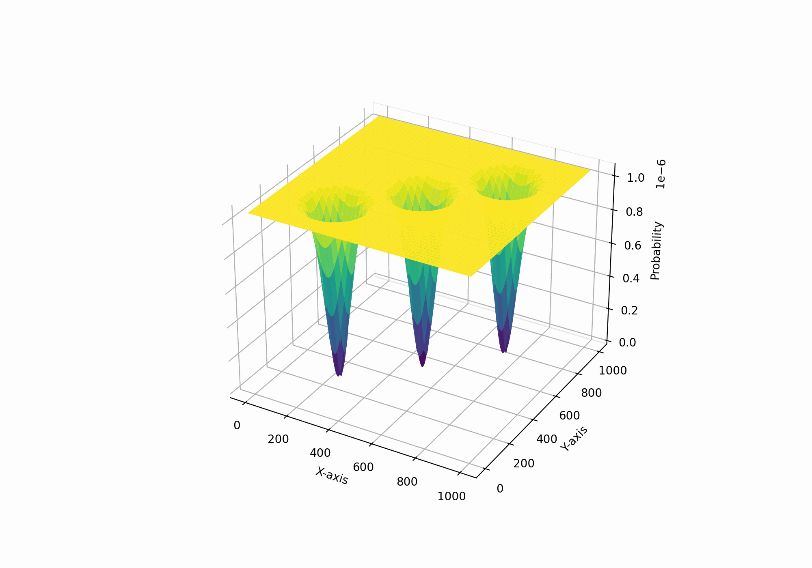
</p>

---

### Trajectory Generation

The discrete waypoints generated by RRT* are interpolated using Spline2D.

This produces a smooth reference trajectory suitable for vehicle control.

```text
RRT* Waypoints
        ↓
Spline2D
        ↓
Smooth Reference Trajectory
```

<p align="center">
  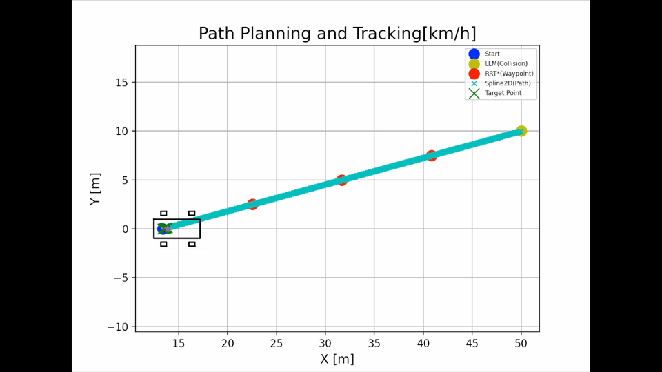
</p>

---

### Model Predictive Control

The generated trajectory is tracked using Model Predictive Control.

MPC optimizes steering commands over a prediction horizon while satisfying vehicle dynamics and actuator constraints.

#### Optimization Objective

$$
\begin{alignedat}{3}
J &= \arg\min_{u}\sum_{k=0}^{N}
\left(
\|z_{k,\mathrm{ref}}-z_k\|_Q^2
+\|u_k\|_R^2
+\|u_{k+1}-u_k\|_{R_d}^2
\right) \\
\text{subject to}\qquad
&\|u_{k+1}-u_k\|<du_{\max} \\
\qquad&
v_{\min}<v_k<v_{\max} \\
&
u_{\min}<u_k<u_{\max} \\
&
z_0=z_{0,\mathrm{ob}} \\
\qquad&
z_{k+1}=Az_k+Bu+C \\
\end{alignedat}
$$

where

| Symbol | Description |
|--------|-------------|
| $z_k$ | Vehicle state at time step $k$ |
| $z_{k,\mathrm{ref}}$ | Reference trajectory state |
| $u_k$ | Control input |
| $Q$ | Tracking error weight |
| $R$ | Control effort weight |
| $R_d$ | Control smoothness weight |

The controller minimizes tracking error, control effort, and steering variation to generate smooth and dynamically feasible vehicle behavior.

#### PID vs. MPC Tracking

| Discrete PID | MPC |
|:---:|:---:|
| 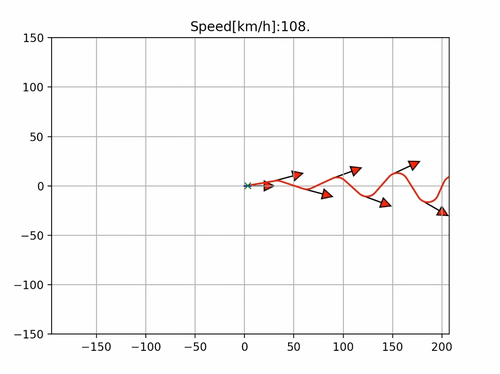 | 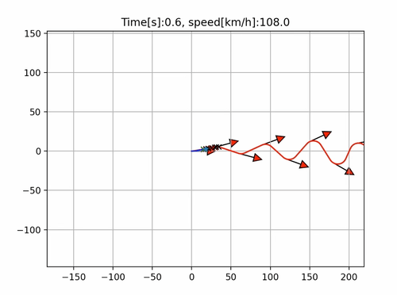 |

| Metric | Discrete PID | MPC |
|--------|-------------:|----:|
| Max error [m] | 25.89 | **3.59** |
| RMSE [m] | 7.46 | **1.62** |

---

## Simulation Environment

The proposed framework was validated using Webots, an open-source robotics simulator suitable for autonomous vehicle research.

### Why Webots?

- Realistic vehicle dynamics simulation
- Fast urban environment modeling
- Native Python controller support
- Efficient debugging and iteration
- Robotics-oriented simulation workflow

<p align="center">
  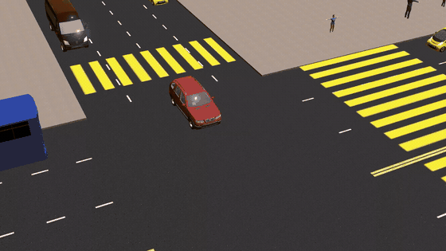
</p>

<p align="center">
  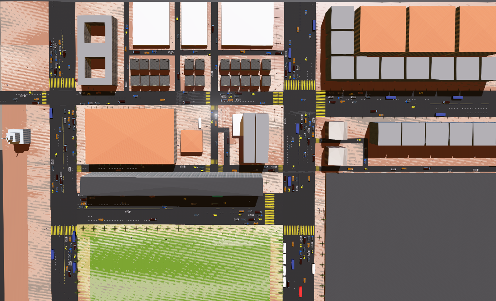
</p>

---

## Experimental Results

The proposed framework was evaluated under multiple emergency driving scenarios with different traffic densities.

Each experiment begins with a Sudden Unintended Acceleration event and evaluates whether the system can reduce casualties while maintaining dynamically feasible vehicle behavior.

---

Three maps were built with different traffic densities.

| Map | Pedestrians | Vehicles |
|-----|------------:|---------:|
| Low | 23 | 63 |
| Medium | 124 | 148 |
| High | 243 | 267 |

### Scenario 1 — Low Traffic Density

This map is the closest to the real Seoul City Hall Station crash.

| Webots | Planning & Tracking |
|:---:|:---:|
| 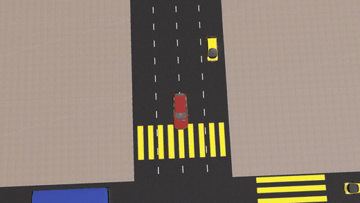 | 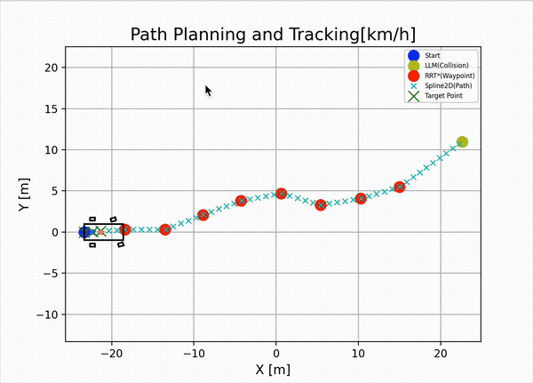 |

**Result:** 3 casualties in simulation (the real crash: 16 casualties).

---

### Scenario 2 — Medium Traffic Density

| Webots | Planning & Tracking |
|:---:|:---:|
| 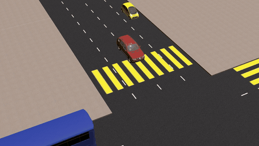 | 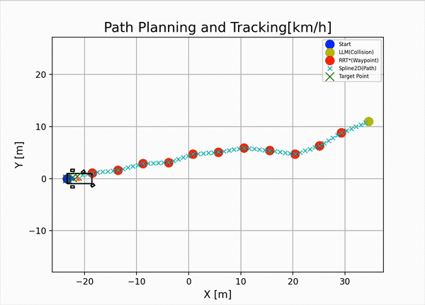 |

**Result:** 3 casualties in simulation.

---

### Scenario 3 — High Traffic Density

Not completed: the simulation became too heavy to run on this map.

---

### Discussion

- Larger maps make each experiment much slower.
- RRT* is random, so the path (and the result) can change between runs.
- Combining RRT* with Dubins paths could give smoother paths.

### Key Outcomes

- LLM-based emergency decision making
- Structured prompt engineering
- Risk-aware path planning
- Spline2D trajectory generation
- MPC trajectory tracking
- End-to-end Webots validation

---

## Software Stack

| Category | Technologies |
|----------|--------------|
| AI | Large Language Models, Prompt Engineering |
| Planning | RRT*, Gaussian Bias Sampling, Spline2D |
| Control | Model Predictive Control |
| Simulation | Webots |
| Programming | Python |
| Libraries | NumPy, Matplotlib |

---

## Repository Structure

```text
RiskAwareEmergencyPlanning/
├── working_space/        # main Webots project
│   ├── controllers/      # vehicle controller (LLM → planner → MPC)
│   ├── path_planner/     # RRT*, Gaussian bias sampling, Spline2D
│   ├── path_tracker/     # PID and MPC trackers
│   ├── opacity_map/      # occupancy grid map
│   ├── protos/           # Webots models
│   └── worlds/           # Seoul City Hall maps (low / medium / high)
├── openai_auto/          # LLM prompt automation
├── animation/            # figure and animation scripts
├── untitled folder/      # early Webots prototype
└── images/               # README figures
```

---

## Future Work

- Vision-Language Model integration
- Camera-based scene understanding
- LiDAR perception
- Dynamic obstacle prediction
- ROS2 deployment
- CARLA simulation
- Real vehicle validation

---

## References

### Project Materials

- Capstone Design 2 final presentation (Chung-Ang University, December 2024)

### Related Topics

- Sampling-based motion planning
- Model Predictive Control
- Prompt engineering for Large Language Models
- Autonomous emergency planning
